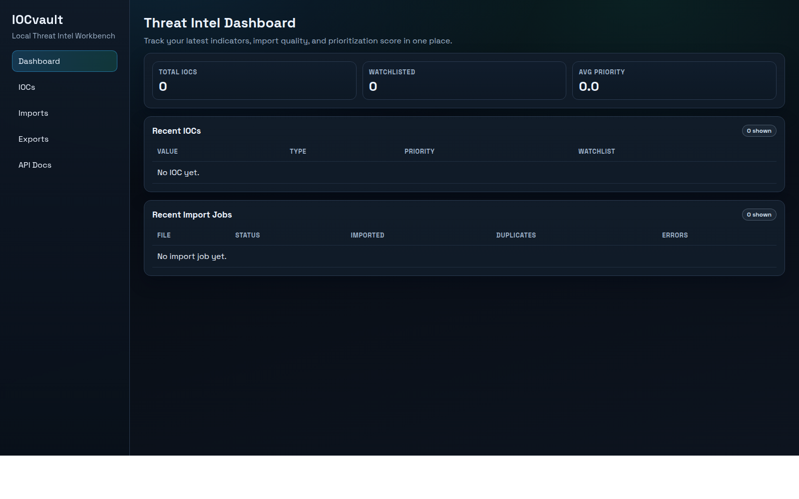
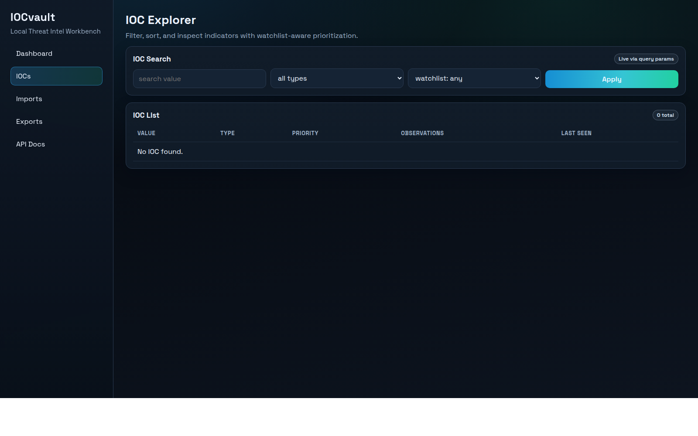
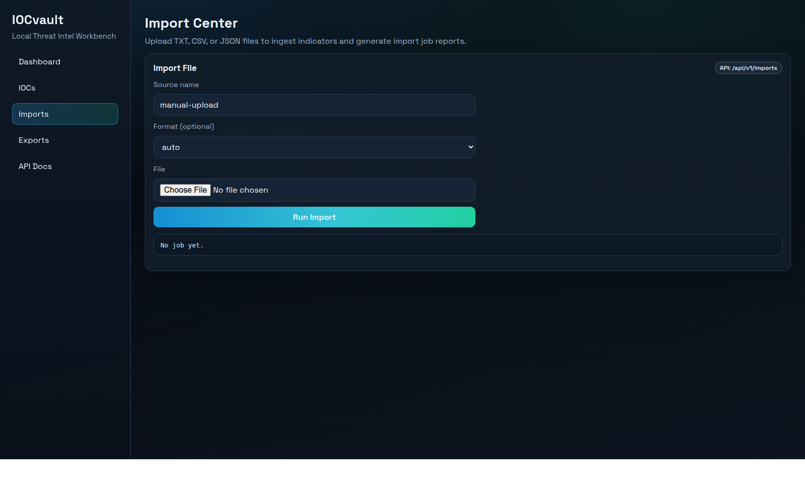
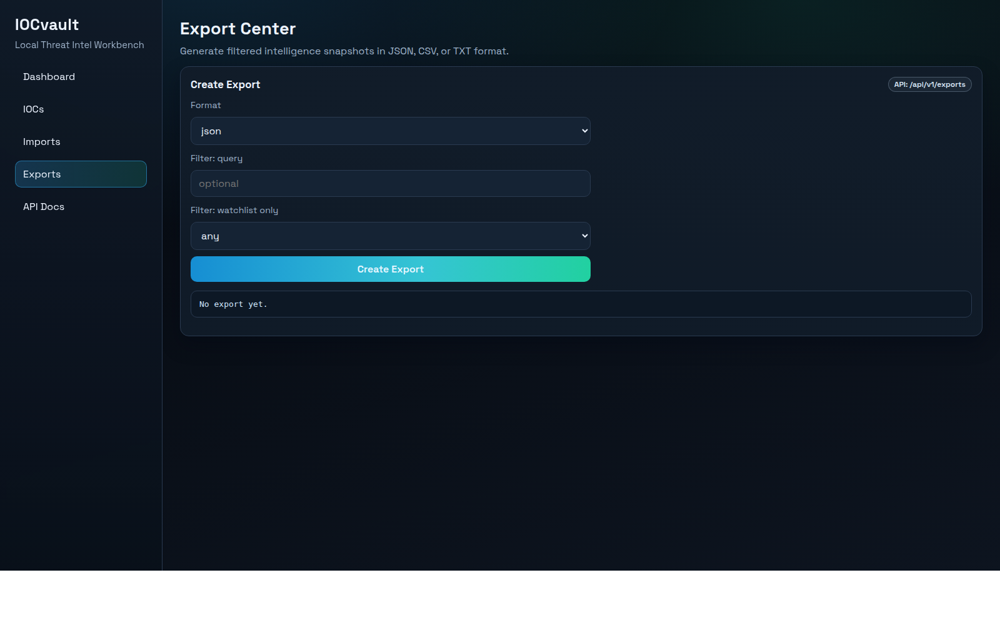

# IOCvault


Local-first IOC aggregation, normalization, scoring, and export workbench.

---

## FR

### Vision

IOCvault existe pour combler l'écart entre un tableur d'IOC et une plateforme CTI lourde.
Le projet permet d'ingérer des IOC hétérogènes, de les normaliser, de les dédupliquer, de les scorer, puis de les exporter rapidement.

### Pourquoi ce projet

- Construire un flux Threat Intel / SOC exploitable localement.
- Éviter les dépendances externes pour la démonstration et le test.
- Garder une architecture claire, testable et évolutive.

### Fonctionnalités actuelles

- Import TXT/CSV/JSON avec job report.
- Normalisation IOC (IP, domaine, URL, hash).
- Déduplication + observation tracking.
- Scoring local (confidence/severity/priority).
- Tags + watchlist.
- Exports `json`, `csv`, `txt`.
- API REST (`/api/v1/*`) + UI web (`/`, `/iocs`, `/imports`, `/exports`).

### Captures d'écran






### Démarrage rapide

#### Option locale

```bash
cd /path/to/Threat_Intel_Aggregator
python3 -m venv .venv
. .venv/bin/activate
pip install -e '.[dev]'
make run
```

Puis ouvrir:
- App web: `http://127.0.0.1:8000/`
- Docs API: `http://127.0.0.1:8000/docs`

#### Option Docker

```bash
docker compose up --build
```

Puis ouvrir:
- App web: `http://127.0.0.1:8000/`
- Docs API: `http://127.0.0.1:8000/docs`

### Qualité et structure

- Lint: `ruff check .`
- Typage: `mypy app`
- Tests: `pytest`
- Docs: `docs/specs/` et `docs/plans/`

---

## EN

### Vision

IOCvault bridges the gap between a spreadsheet-based IOC workflow and a heavy CTI platform.
It ingests heterogeneous indicators, normalizes and deduplicates them, applies explainable scoring, and exports the result quickly.

### Why this project

- Build a practical local Threat Intel / SOC workflow.
- Remove external dependencies for easy demo and testing.
- Keep the architecture clean, testable, and extensible.

### Current features

- TXT/CSV/JSON import with job report.
- IOC normalization (IP, domain, URL, hash).
- Deduplication + observation tracking.
- Local scoring (confidence/severity/priority).
- Tags + watchlist.
- `json`, `csv`, `txt` exports.
- REST API (`/api/v1/*`) + web UI (`/`, `/iocs`, `/imports`, `/exports`).

### Screenshots


### Quick start

#### Local

```bash
cd /path/to/Threat_Intel_Aggregator
python3 -m venv .venv
. .venv/bin/activate
pip install -e '.[dev]'
make run
```

Then open:
- Web app: `http://127.0.0.1:8000/`
- API docs: `http://127.0.0.1:8000/docs`

#### Docker

```bash
docker compose up --build
```

Then open:
- Web app: `http://127.0.0.1:8000/`
- API docs: `http://127.0.0.1:8000/docs`

### Commands

- Run app: `make run`
- Run tests locally: `make test`
- Run tests in Docker: `make docker-test`
- Start Docker app: `make docker-up`

### Demo data

- Import [samples/demo_iocs.csv](samples/demo_iocs.csv) from the Import Center to seed a realistic IOC set.

### Quality and docs

- Lint: `ruff check .`
- Types: `mypy app`
- Tests: `pytest`
- Docs: `docs/specs/` and `docs/plans/`

---

## Release

Current stable tag: `v0.1.0` (API + Web UI + import/score/export baseline).
